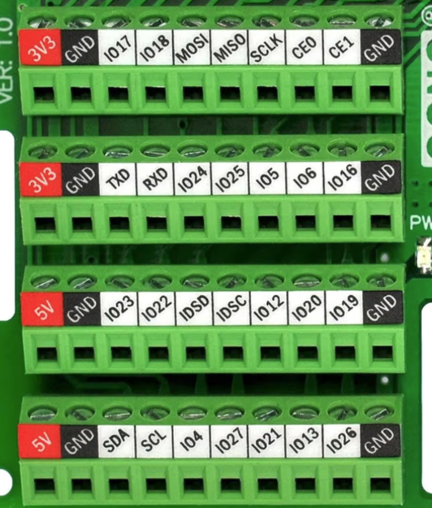

# Power hat GPIO

Labels are the silkscreen on the power hat. Rows run from the top of the photo to the bottom, and each row is left to right. The assignment matches `config.yaml`. This page does not change the pinout.

**Top row**

| Hat | Signal |
|-----|--------|
| 3V3 | 3.3 V |
| GND | Ground |
| IO17 | Level Critical |
| IO18 | Leak Sensor |
| MOSI | SPI, unused |
| MISO | SPI, unused |
| SCLK | SPI, unused |
| CE0 | SPI, unused |
| CE1 | SPI, unused |
| GND | Ground |

**Second row**

| Hat | Signal |
|-----|--------|
| 3V3 | 3.3 V |
| GND | Ground |
| TXD | Unused |
| RXD | Unused |
| IO24 | Pump ENA |
| IO25 | Pump DIR |
| IO5 | Pump PUL |
| IO6 | Acoustic signal |
| IO16 | Cartridge In Place |
| GND | Ground |

**Third row**

| Hat | Signal |
|-----|--------|
| 5V | 5 V |
| GND | Ground |
| IO23 | I2C6 clock — thermistors 8–11 (0x48) and flow (0x49) |
| IO22 | I2C6 data — thermistors 8–11 (0x48) and flow (0x49) |
| IDSD | Hat ID, unused |
| IDSC | Hat ID, unused |
| IO12 | Pump Closed |
| IO20 | Level Low |
| IO19 | Compressor |
| GND | Ground |

**Bottom row**

| Hat | Signal |
|-----|--------|
| 5V | 5 V |
| GND | Ground |
| SDA | I2C1 data — pump pressure 0x48, reserve thermistors 0x49, thermistors 0–7 at 0x4A/0x4B |
| SCL | I2C1 clock — pump pressure 0x48, reserve thermistors 0x49, thermistors 0–7 at 0x4A/0x4B |
| IO4 | UPS shutdown output |
| IO27 | Ready |
| IO21 | Battery Mode |
| IO13 | Alarm |
| IO26 | DC OK |
| GND | Ground |

Levels used by the runtime:

- Compressor on IO19 is active-high. High turns the compressor on.
- Pump ENA on IO24 is active-low. Low energizes the motor.
- Leak Sensor, Level Low, Level Critical, and Cartridge In Place use a pull-up. An open switch reads on. Short the switch wire to ground for off.
- Pump Closed on IO12 uses a pull-up and is active-low. Short IO12 to ground when the head is latched. An open switch reads off.
- UPS inputs (DC OK, Alarm, Battery Mode, Ready) are active-low with a pull-down. A low pin reads on.
- UPS shutdown on IO4 is an output. Low commands the UPS to shut down. Idle is high.
