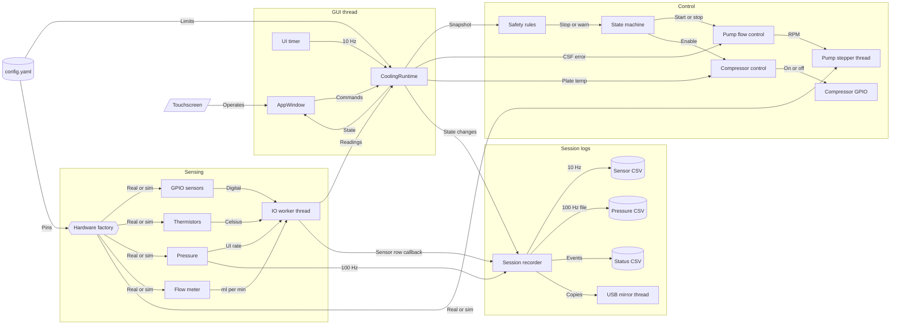

# Runtime architecture

# Threads

| Thread | Owns |
|--------|------|
| GUI | `AppWindow`, `CoolingRuntime`, the state machine, pump and compressor decisions |
| IO worker | Sensor reads, and the sensor-CSV callback |
| Stepper | Step pulses, through pigpio. The control loop only sets RPM and run or stop |
| Pressure capture | The pressure CSV, at `sensors.pressure.capture_rate_hz` (100 Hz unless config changes it) |
| USB mirror | Copying new log bytes onto the stick |